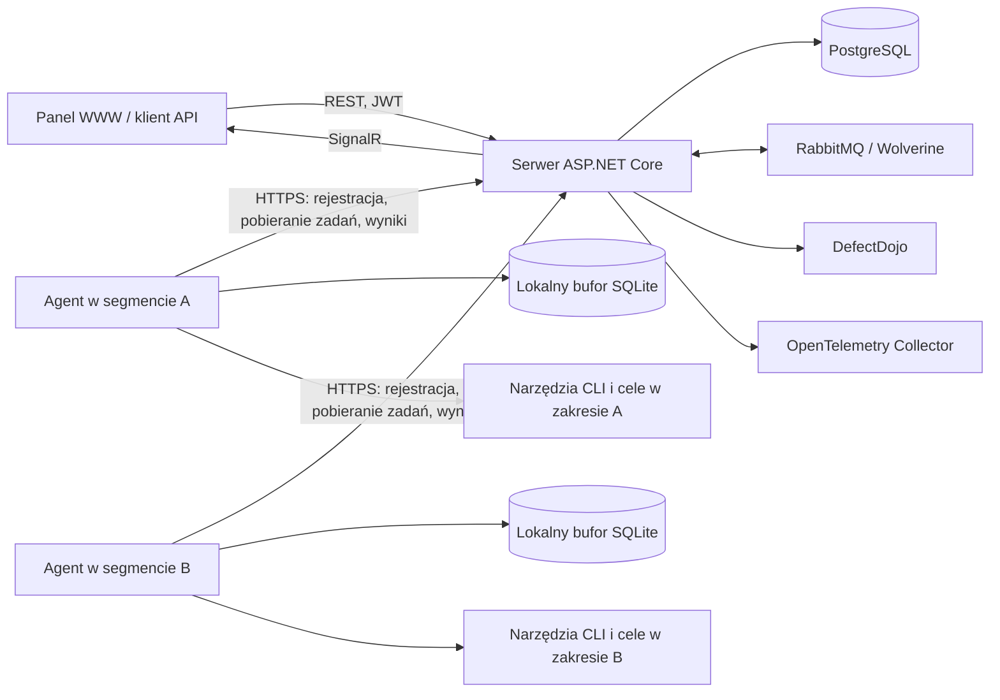

# ip_cat — dokumentacja techniczna

Rozproszony system inwentaryzacji infrastruktury i analizy powierzchni ataku

## 1. Przeznaczenie i zakres

WebScan służy do cyklicznego wykrywania hostów i usług w rozległych sieciach, identyfikowania technologii oraz porównywania obserwacji w czasie. Centralny serwer zarządza zakresem, harmonogramami i wynikami, a agenci wykonują pomiary z przypisanych segmentów sieci. System przechowuje historię obserwacji oraz oddzielne metadane analityczne, które można edytować również podczas trwającego skanu.

Dokument opisuje implementację prototypu zadania „Attack Surface Intelligence” dla CBI AGH. Zakres wynika z rozdziałów 2–6 pełnej treści zadania: discovery ponad 10 000 adresów, ograniczanie ruchu, okna czasowe, fingerprinting, własne sygnatury, import i eksport, porównywanie skanów, RBAC oraz ochrona przechowywanych danych. Dokumentacja dotyczy serwera, agentów, kontraktów integracyjnych i procedur eksploatacyjnych. Operacje użytkownika opisano przez ich znaczenie oraz endpointy API; rozmieszczenie elementów panelu może się zmieniać niezależnie od backendu.

Wykrycie produktu, panelu lub charakterystycznego artefaktu jest informacją do analizy. Samo dopasowanie sygnatury nie potwierdza podatności ani skutecznej eksploatacji.

### 1.1. Pojęcia

| Pojęcie | Znaczenie |
|---|---|
| Strefa (`zone`) | Oddzielna przestrzeń adresowa, np. VLAN, VRF lub segment z nakładającą się adresacją |
| Sieć (`network`) | Nazwany zbiór adresów IP, CIDR i domen, wykluczeń oraz limitów przypisany do strefy |
| Workflow | Wersjonowany graf operacji wykonywanych podczas skanowania |
| Przebieg (`scan run`) | Jedno uruchomienie konkretnej wersji workflow dla wybranych sieci |
| Zadanie (`job`) | Partia celów dla jednej operacji, narzędzia i perspektywy agenta |
| Dzierżawa (`lease`) | Czasowe prawo konkretnego agenta do wykonania zadania |
| Obserwacja | Znormalizowany wynik pomiaru z czasem, źródłem i powiązaniem z przebiegiem |
| Znalezisko (`finding`) | Dopasowanie sygnatury lub artefakt wymagający analizy, z poziomem istotności i stanem obsługi |
| Pokrycie (`coverage`) | Informacja, jakie cele i operacje rzeczywiście objął przebieg oraz czy pomiar był kompletny |

## 2. Architektura



### 2.1. Komponenty i technologie

| Komponent | Implementacja i odpowiedzialność |
|---|---|
| Serwer | C#, ASP.NET Core, .NET 10; modularny monolit z REST API i SignalR |
| Agent | .NET 10 Worker; inwentaryzacja interfejsów, uruchamianie narzędzi, parsowanie i wysyłka wyników |
| Trwałe dane | PostgreSQL 17, Entity Framework Core 10; osobny schemat i kontekst danych dla modułu |
| Komunikacja wewnętrzna | Wolverine, RabbitMQ i trwałe wiadomości w PostgreSQL; lokalny transport przy braku konfiguracji RabbitMQ |
| Harmonogramy | Quartz; definicje w PostgreSQL, wyzwalacze odtwarzane w pamięci procesu |
| Bufor agenta | SQLite w trwałym katalogu danych agenta |
| Klient WWW w repozytorium | React, TypeScript, Vite; komunikacja przez `/api` i `/hubs` |
| Monitoring | OpenTelemetry, opcjonalnie Collector, Prometheus i Grafana |

Agenci inicjują wszystkie połączenia do kontrolera. Serwer nie otwiera połączeń przychodzących do agentów, co upraszcza pracę przez NAT i zapory. Agenci nie mają dostępu do bazy PostgreSQL.

### 2.2. Podział serwera

| Moduł | Zadania |
|---|---|
| `Identity` | Użytkownicy, logowanie, role i zarządzanie hasłami |
| `Agents` | Rejestracja, status, poświadczenia, przypisania i katalog narzędzi |
| `Networks` | Sieci, strefy, import zakresów, globalna polityka skanowania |
| `Scanning` | Planowanie partii, limity, kolejka, dzierżawy i przyjmowanie wyników |
| `Scheduling` | Cron, okna czasowe, zasady nakładania przebiegów i ponowny start |
| `Workflows` | Definicje DAG, walidacja, wykonanie kroków i import wyników jako przebiegów |
| `Discovery` | Normalizacja, aktualny stan zasobów, fingerprinting, historia i wykrywanie zmian |
| `Signatures` | Wersjonowanie, walidacja, zatwierdzanie i wycofywanie sygnatur |
| `Analytics` | Analizy i porównania przebiegów |
| `Integrations` | Konfiguracja i eksport do DefectDojo |
| `Infrastructure` | Audyt, uwierzytelnianie, szyfrowanie, migracje, komunikacja i telemetria |

Moduły komunikują się przez interfejsy w `src/Server/Kernel` i wiadomości domenowe. Wspólne kontrakty serwera i agenta znajdują się w `src/Shared/Contracts`. Poszczególne schematy bazy przechowują identyfikatory powiązanych obiektów; nie stosuje się kluczy obcych między schematami modułów.

### 2.3. Struktura repozytorium

```text
src/Server/Api/          punkt startowy serwera
src/Server/Kernel/       interfejsy modułów i polityki bezpieczeństwa
src/Server/Infrastructure/
src/Server/Modules/      moduły funkcjonalne i migracje
src/Shared/Contracts/    DTO, operacje, walidacja parametrów
src/Agent/              Worker, rdzeń wykonania, parsery i manifesty
src/Frontend/           klient WWW
deploy/docker/          główny stos Compose, certyfikaty i monitoring
deploy/organizer-lab/   instancja do laboratorium organizatora
tests/UnitTests/        testy poszczególnych obszarów
tests/E2ETests/         scenariusze serwera i przeglądarki
tests/TestLab/          kontrolowane hosty i usługi testowe
docs/                   instrukcje techniczne
```

## 3. Instalacja i uruchomienie

### 3.1. Wymagania środowiskowe

Do uruchomienia kontenerowego potrzebne są Docker z Compose v2, dostęp do rejestrów obrazów i źródeł narzędzi podczas budowania oraz wolne miejsce na obrazy i dane. Dla pełnego zestawu z laboratorium należy przewidzieć około 15–20 GB miejsca; nie jest to pomiar zapotrzebowania działającego serwera.

Budowanie poza Dockerem wymaga .NET SDK wskazanego w `global.json` — `10.0.203`, z `rollForward: latestFeature`. Klient WWW z repozytorium wymaga Node.js 22+ i npm 10+. Skrypt certyfikatów wymaga powłoki `sh` i OpenSSL; na Windows można użyć Git Bash lub WSL.

Agent musi mieć trasę do skanowanych adresów i możliwość połączenia HTTPS z serwerem. Techniki SYN/ARP/ICMP wymagają odpowiednich uprawnień do surowych gniazd. Obraz agenta zawiera narzędzia z uprawnieniem `cap_net_raw`; proces aplikacji działa jako użytkownik bez uprawnień roota.

### 3.2. Konfiguracja i start lokalnego laboratorium

Polecenia wykonuje się z katalogu głównego repozytorium. W Bash:

```bash
cp deploy/docker/.env.example deploy/docker/.env
```

W PowerShell odpowiednikiem jest:

```powershell
Copy-Item deploy/docker/.env.example deploy/docker/.env
```

Przed startem należy zmienić przykładowe hasła i tokeny w `.env`: `POSTGRES_PASSWORD`, `RABBITMQ_PASSWORD`, `JWT_SIGNING_KEY`, `ADMIN_PASSWORD`, `AGENT_ENROLLMENT_TOKEN` oraz hasła Grafany, jeśli jest używana. Klucz JWT musi mieć co najmniej 32 znaki; hasło administratora co najmniej 12 znaków. Plik `.env` zawiera sekrety i nie powinien być dołączany do repozytorium ani pakietu zgłoszeniowego.

Następnie w Bash/Git Bash/WSL:

```bash
(cd deploy/docker/certs && sh generate-certs.sh)
docker compose -p webscan --env-file deploy/docker/.env -f deploy/docker/docker-compose.yml -f tests/TestLab/docker-compose.yml up -d --build
```

Skrypt tworzy lokalny urząd certyfikacji oraz certyfikat serwera dla nazw używanych w środowisku demonstracyjnym. Agenci ufają temu CA przez zamontowany `ca.crt`.

```bash
docker compose -p webscan --env-file deploy/docker/.env -f deploy/docker/docker-compose.yml -f tests/TestLab/docker-compose.yml ps
docker compose -p webscan --env-file deploy/docker/.env -f deploy/docker/docker-compose.yml logs --tail 100 server agent-1 agent-2
```

| Usługa | Adres lokalny |
|---|---|
| Panel WWW z obrazu repozytorium | `http://localhost:8088` |
| API przez proxy panelu | `http://localhost:8088/api` |
| API HTTPS dla agentów | `https://localhost:5443` |
| API HTTP do lokalnego rozwoju | `http://localhost:5080` |
| RabbitMQ Management | `http://localhost:15672` |
| PostgreSQL | `localhost:5432`, o ile nie zmieniono `POSTGRES_PORT` |

Konto startowe pochodzi z `ADMIN_USERNAME` i `ADMIN_PASSWORD`. Bootstrap tworzy administratora przy pustej tabeli użytkowników; zmiana `.env` nie zastępuje hasła istniejącego konta.

Compose uruchamia dwóch agentów, przypisuje ich do strefy `lab` i zasiewa dozwolony zakres `172.30.0.0/24`. Nie jest to ogólna polityka produkcyjna. Poza konfiguracją zasiewającą pusta polityka nie zezwala na skanowanie żadnych celów.

### 3.3. Start bez panelu WWW

Serwer i laboratorium można uruchomić niezależnie od budowanego frontendu:

```bash
docker compose -p webscan --env-file deploy/docker/.env -f deploy/docker/docker-compose.yml -f tests/TestLab/docker-compose.yml up -d --build postgres rabbitmq server agent-1 agent-2 nginx apache webapp admin-panel banner
```

Nazwy usług laboratoryjnych i ich adresy opisuje [instrukcja TestLab](../tests/TestLab/README.md). Nowy klient należy kierować do serwera przez proxy obsługujące `/api` i `/hubs`. Backend nie konfiguruje ogólnego dostępu CORS między dowolnymi originami. Dla publikacji panelu należy zapewnić HTTPS także na połączeniu przeglądarki z proxy; podane adresy HTTP służą lokalnemu demo.

### 3.4. Rozwój lokalny i agent natywny

Po uruchomieniu PostgreSQL i RabbitMQ serwer można uruchomić poleceniem:

```bash
dotnet run --project src/Server/Api
```

Parametry połączenia, klucz JWT i bootstrap przekazuje się przez konfigurację .NET, np. zmienne środowiskowe z podwójnym podkreśleniem zamiast `:`. Dane połączenia muszą odpowiadać `.env` kontenerów. Ustawienia lokalne znajdują się również w `appsettings.Development.json`. W środowisku `Development` dostępne są `/openapi/v1.json` i interfejs `/scalar`.

Agent natywny, po zainstalowaniu narzędzi i utworzeniu tokenu zapisu:

```bash
dotnet run --project src/Agent/Worker -- --list-tools
dotnet run --project src/Agent/Worker -- --Agent:ServerUrl=https://localhost:5443 --Server:CaCertificatePath=deploy/docker/certs/ca.crt --Agent:AgentId=local-agent --Agent:EnrollmentToken=TOKEN_ZAPISU --Agent:MaxRatePerSecond=300
```

Token zastępuje się wartością wygenerowaną przez administratora. Kolejne uruchomienia korzystają z zapisanych poświadczeń. Każdy agent musi mieć własny trwały katalog danych. Na Windows i macOS agent natywny lepiej odwzorowuje dostęp do LAN niż kontener za NAT Docker Desktop. Procedurę opisuje [skanowanie sieci lokalnej](LOCAL-NETWORK.md).

### 3.5. Najważniejsze ustawienia

| Klucz konfiguracji | Znaczenie |
|---|---|
| `ConnectionStrings:WebScan` | Połączenie wszystkich modułów z PostgreSQL |
| `Database:MigrateOnStartup` | Automatyczne zastosowanie migracji, domyślnie `true` |
| `RabbitMq:ConnectionString` | Połączenie z brokerem; brak przełącza na lokalne trwałe kolejki |
| `Auth:Jwt:SigningKey` | Klucz podpisujący tokeny użytkowników |
| `Bootstrap:AdminUserName`, `Bootstrap:AdminPassword` | Utworzenie pierwszego administratora |
| `Networks:SeedScopePolicy:*` | Początkowy zakres i ograniczenia portów |
| `Agents:BootstrapEnrollmentToken`, `Agents:BootstrapEnrollmentZones` | Automatyczny zapis agentów w kontrolowanym wdrożeniu |
| `Agents:HeartbeatTimeoutSeconds` | Czas uznania agenta za niedostępnego |
| `Planner:ToolPreference:*` | Preferowane narzędzia dla poszczególnych możliwości |
| `DataProtection:CertificatePath`, `DataProtection:CertificatePassword` | Certyfikat PKCS#12 chroniący klucze szyfrowania |
| `DataProtection:KeyLifetimeDays` | Okres tworzenia nowego klucza, domyślnie 90 dni |
| `Agent:MaxConcurrentJobs` | Współbieżność agenta, domyślnie 4 |
| `Agent:MaxRatePerSecond` | Limit tempa agenta, domyślnie 2000 |
| `Agent:DataDirectory` | SQLite i poświadczenia; w kontenerze `/var/lib/webscan-agent` |
| `Agent:ToolManifestPaths`, `Agent:PluginPaths` | Lokalne manifesty i rozszerzenia parserów |
| `Server:CaCertificatePath` | CA używane przez agenta do weryfikacji serwera |
| `OpenTelemetry:OtlpEndpoint` | Eksport telemetrii |

## 4. Zakres i przygotowanie skanu

### 4.1. Autoryzacja celów

Administrator określa globalną politykę: `allowed`, `excluded`, `allowedPorts` i `excludedPorts`. Pusta lista dozwolonych celów blokuje skanowanie. Puste `allowedPorts` oznacza wszystkie porty z pominięciem `excludedPorts`. Sieć musi mieścić się w polityce, a zadania w zakresie sieci. Wykluczenia zawężają zakres pomiaru.

Weryfikacja odbywa się przy zapisie sieci, planowaniu i wykonaniu zadania przez agenta. Endpoint z nazwą hosta jest sprawdzany także pod kątem tej nazwy, ponieważ wpływa ona na DNS, HTTP Host i TLS SNI. Parametry portów i endpointy muszą mieścić się w `AuthorizedPorts` zadania.

Rekomendowana kolejność przygotowania:

1. Ustalić dozwolone adresy, porty, wykluczenia i limit ruchu dla laboratorium.
2. Zapisać politykę globalną jako Administrator.
3. Utworzyć strefę i sieć w jej obrębie.
4. Zarejestrować agenta i nadać mu dostęp do odpowiedniej strefy lub sieci.
5. Sprawdzić status agenta, trasę, narzędzia i ich zatwierdzenie.
6. Wybrać workflow, limit tempa i okno czasowe; sprawdzić estymację przed uruchomieniem.

Podsieci zgłaszane przez agentów można odczytać przez `GET /api/networks/agent-subnets`. Wykrycie podsieci nie nadaje uprawnień do jej skanowania; nadal wymagana jest zgodność z polityką.

### 4.2. Domyślny przebieg

Workflow `standard-discovery` wykonuje:

1. Przegląd całego zakresu operacją `ScanPorts`: lista top-1000 rozszerzona o typowe porty baz danych, brokerów i paneli. Preferowany jest masscan, a przy braku możliwości wykonania odpowiednie naabu lub nmap.
2. Skan top-1000 portów TCP hostów, na których przegląd wykrył otwarte porty.
3. Rozpoznawanie usług na endpointach znalezionych w obu etapach.
4. Sondowanie HTTP oraz równoległą gałąź TLS dla odpowiednich usług. HTTP obejmuje także wybrane nierozpoznane usługi na nietypowych portach.
5. Wykonanie zatwierdzonych sygnatur na endpointach HTTP, domyślnie dla poziomów `info` i `low`.
6. Ponowny pomiar brakujących zasobów (`RecheckMissing`).
7. Utrwalenie i przetworzenie obserwacji, porównanie z historią oraz publikację znalezisk.

`full-discovery` rozszerza drugi etap do portów TCP `1-65535`. Pierwszy przegląd nadal korzysta z ograniczonej listy portów, dlatego host udostępniający wyłącznie port spoza tej listy może zostać pominięty. Pełne badanie wszystkich adresów i wszystkich portów wymaga własnego workflow z odpowiednim wejściowym `ScanPorts`, kosztem znacznie większego ruchu i czasu.

### 4.3. Planowanie dużych zakresów

Planer dzieli zakres na partie oraz dobiera agentów według uprawnień, dostępności, tras, interfejsów, narzędzi i obsługiwanych parametrów. Bezpośrednio podłączone interfejsy są preferowane względem dostępu przez bramę. Rozmiar partii może być dopasowywany do szybkości wykonania i docelowego czasu zadania. Limity obejmują m.in. równoległość i ruch globalny oraz ograniczenia stref, interfejsów i podsieci.

Przypisany interfejs pozostaje stały dla kombinacji agent–przebieg–sieć we wszystkich krokach workflow. Chwilowe zajęcie interfejsu powoduje oczekiwanie, aby zachować tę samą perspektywę pomiarową. Różne sieci mogą być mierzone równolegle przez inne interfejsy tego samego agenta.

`POST /api/scans/estimate` zwraca liczbę adresów, estymaty początkowych kroków, przewidywany przedział czasu i ostrzeżenia dotyczące okna. Dalsze etapy zależą od liczby wykrytych hostów, portów i endpointów HTTP; estymata nie gwarantuje czasu zakończenia. Limity administracyjne odczytuje i zapisuje się przez `/api/scan-limits`.

### 4.4. Odporność wykonania

Agent pobiera zadania i odnawia dzierżawę przez heartbeat. Wyniki są porcjowane, lokalnie buforowane w SQLite i wysyłane z identyfikatorami partii oraz obserwacji. Ponowna dostawa jest obsługiwana idempotentnie. Przyjęcie wyników i publikacja wiadomości do dalszego przetwarzania korzystają z trwałego mechanizmu outbox.

Utrata agenta lub wygaśnięcie dzierżawy pozwala odzyskać pracę przez kolejkę. Wyniki dla nieaktualnej dzierżawy są odrzucane. Ponowne wykonanie zadania jest możliwe, dlatego identyfikatory i deduplikacja chronią stan danych przed skutkami powtórnych dostaw. Timeout, anulowanie i zatrzymanie agenta przerywają uruchomione narzędzia; zakończenie procesu i wysyłka bufora wymagają czasu technicznego.

## 5. Harmonogramy i okna czasowe

Harmonogram wskazuje sieci, workflow, strefę czasową IANA, wyrażenie cron Quartz, dozwolone okna, maksymalny czas i limit ruchu. Quartz używa pola sekund: `0 0 2 * * ?` oznacza uruchomienie o 02:00 w strefie harmonogramu. Okna mogą przechodzić przez północ.

Przykładowe ciało `POST /api/schedules`; `networkIds` należy zastąpić identyfikatorem utworzonej sieci:

```json
{
  "name": "Nocna inwentaryzacja laboratorium",
  "cronExpression": "0 0 2 * * ?",
  "timeZone": "Europe/Warsaw",
  "workflowKey": "standard-discovery",
  "networkIds": ["11111111-1111-1111-1111-111111111111"],
  "priority": 50,
  "maxRatePerSecond": 300,
  "windowDurationMinutes": 60,
  "allowedWindows": [{
    "daysOfWeek": ["Monday", "Tuesday", "Wednesday", "Thursday", "Friday", "Saturday", "Sunday"],
    "start": "02:00",
    "end": "03:00"
  }],
  "overlapPolicy": "Skip",
  "resumeInNextWindow": true,
  "enabled": true
}
```

Przy aktywnym poprzednim przebiegu dostępne są zasady `Skip`, `Queue` i `CancelPrevious`. Kolejkowanie przechowuje odroczone wyzwolenie; uruchomienie po zakończeniu poprzedniego nadal podlega ograniczeniu okna. Ręczne wyzwolenie harmonogramu omija sprawdzenie przynależności do dozwolonego okna, ale okno, w które trafiło, może ograniczyć czas wykonania.

Po przekroczeniu granicy czasu przebieg otrzymuje stan `WindowExpired`, praca sieciowa jest zatrzymywana, a częściowe wyniki zachowywane. Niekompletny pomiar nie jest podstawą uznania zasobów za znikające. Gdy `resumeInNextWindow=true`, harmonogram jest aktywny i ma `allowedWindows`, system planuje dodatkowe uruchomienie na początek następnego dozwolonego okna. Jest to nowy przebieg całego zakresu, a nie kontynuacja od ostatniego adresu. Ręczny skan bez harmonogramu nie ma automatycznego ponownego startu.

## 6. Wyniki, fingerprinting i interpretacja

### 6.1. Model danych

Host jest identyfikowany przez parę `(zone, address)`, a usługa przez hosta, port i transport. Ten sam adres w dwóch strefach oznacza dwa odrębne zasoby. MAC i producent są atrybutami, nie kluczem tożsamości.

Obserwacja zawiera identyfikatory przebiegu i zadania, czas pomiaru, adres, opcjonalną nazwę i port, rodzaj wyniku oraz źródło: agenta, interfejs i narzędzie. Szczegóły zależą od rodzaju: status hosta, otwarty port, usługa, HTTP, TLS, technologia lub dopasowanie sygnatury. Aktualny stan zasobów jest aktualizowany na podstawie obserwacji; historia pozostaje dostępna do dalszej analizy.

### 6.2. Dane HTTP i TLS

System zbiera m.in. URL, kod HTTP, tytuł, serwer WWW, typ zawartości, nagłówki, nazwy i atrybuty cookies, przekierowania, końcowy URL i fingerprint favicony. TLS obejmuje dane certyfikatu, wystawcę, nazwy, ważność i fingerprint SHA-256. Dostępność konkretnego pola zależy od odpowiedzi usługi i użytego narzędzia.

Wartości sesyjnych cookies i tokeny są maskowane. Zachowywane są nazwy cookies i atrybuty, takie jak `Secure`, `HttpOnly`, `SameSite`, domena i ścieżka. Dla rozpoznanych nieszyfrowanych cookies F5 BIG-IP można zapisać zdekodowany adres i port backendu jako artefakt infrastrukturalny; surowa wartość cookie nie jest utrwalana jako sekret sesji.

Fingerprinting wykorzystuje wyniki httpx, rozpoznawanie usług nmap/nerva, pasywne dopasowania Rapid7 recog oraz zatwierdzone reguły klasyfikacji i szablony Nuclei. Recog analizuje już zebrane banery, nagłówki, tytuły, cookies, favikony i certyfikaty bez dodatkowego ruchu. Klasyfikacje obejmują m.in. CMS, panele administracyjne, staging, urządzenia sieciowe, drukarki, kamery i NAS.

### 6.3. Pewność identyfikacji

Każdy dowód ma metodę i wynik w zakresie 0–1. Domyślne wartości w `ConfidenceModel`:

| Metoda | Wynik bazowy |
|---|---|
| Dopasowanie sygnatury | 0,9 |
| Sonda wersji | 0,8 |
| Recog | 0,8, o ile fingerprint nie określa własnej pewności |
| Dopasowanie banera | 0,7 |
| Technologia zgłoszona przez narzędzie | 0,6 |
| Heurystyka oparta na porcie | 0,3 |

Wynik jawnie zgłoszony przez narzędzie lub regułę może zastąpić bazowy. Przy łączeniu dowodów technologii liczy się najlepszy wynik każdej metody, a następnie `confidence = 1 − iloczyn(1 − wynik_metody)`. Powtórzenie tej samej metody nie podnosi wyniku. Dwie metody z wynikami 0,8 i 0,7 dają 0,94. To deterministyczny wskaźnik siły przesłanek przy założeniu niezależności metod, a nie empirycznie skalibrowane prawdopodobieństwo poprawności.

### 6.4. Zmiany i niestabilność

Porównanie wykrywa nowe hosty, porty i usługi, zniknięcia i powroty hostów, zmiany produktu lub wersji, technologii, certyfikatu oraz odpowiedzi HTTP. API udostępnia historię zmian i różnice między dwoma wskazanymi przebiegami.

Brak odpowiedzi liczy się jako pominięcie tylko wtedy, gdy kompletny skan rzeczywiście pokrywał dany cel odpowiednią operacją. Domyślny `missingThreshold=3` oznacza trzy kolejne kompletne pomiary bez odpowiedzi przed zgłoszeniem zniknięcia. Jest to liczba pomiarów, nie stały czas: dla skanów godzinowych próg osiąga się inaczej niż dla skanów dziennych. Po pierwszym takim braku host przechodzi do `Unreachable`; po osiągnięciu progu do `Gone`.

`RecheckMissing` ponawia pomiary brakujących zasobów, domyślnie w dwóch rundach z przerwą 30 sekund. Historia przejść widoczny/niewidoczny pozwala oznaczać hosty niestabilne; dla takich hostów ograniczane są powtarzające się zdarzenia zniknięcia i powrotu. Liczniki godzinowe oraz fingerprinty HTTP pomagają rozpoznać zmienność zależną od pory dnia. Godzinowe agregaty obserwacji są liczone w UTC, niezależnie od strefy harmonogramu.

### 6.5. Analiza i dashboard

`GET /api/dashboard/summary` i `/api/dashboard/insights` dostarczają danych do przeglądu stanu infrastruktury i priorytetów. Hosty i usługi można filtrować i sortować według zainteresowania analitycznego (`sort=interest`, `minInterest`). Wynik zainteresowania oraz jego przyczyny pomagają wybrać zasoby do analizy; nie zastępują oceny ryzyka.

Topologia przedstawia strefy, podsieci, hosty i perspektywy agentów. Powiązanie urządzeń sieciowych jest wnioskowane z MAC współdzielonego między strefami. Nie jest to fizyczna mapa portów przełączników ani wynik LLDP/CDP.

## 7. Ręczne dane, import i eksport

### 7.1. Zakresy skanowania

Sieć można utworzyć ręcznie przez `POST /api/networks` lub zaimportować przez `POST /api/networks/import?format=json|csv`. Dane z obu źródeł podlegają tej samej walidacji zakresu i są później skanowane tym samym mechanizmem.

Przykładowy obiekt sieci:

```json
{
  "name": "laboratorium",
  "zone": "lab",
  "ranges": ["172.30.0.0/24"],
  "exclusions": ["172.30.0.1"],
  "tags": ["demo"],
  "maxRatePerSecond": 300,
  "enabled": true
}
```

Import JSON przyjmuje tablicę takich obiektów. CSV zawiera nagłówek, np.:

```csv
name,zone,ranges,exclusions,tags,description
laboratorium,lab,172.30.0.0/24,172.30.0.1,demo,Sieć testowa
```

W polach wielowartościowych CSV stosuje się separator `;`. Do `ranges` można przekazywać adresy, CIDR i nazwy domen; każda pozycja musi być zgodna z polityką.

### 7.2. Import wyników pomiaru

`POST /api/scans/import?format=json&zone=lab&snapshot=false` przyjmuje tablicę płaskich rekordów JSON lub obiekt `{"items":[...]}`. Odpowiednik CSV używa `format=csv`. Plik przekazuje się bezpośrednio jako ciało HTTP, z typem `application/json` lub `text/csv`.

```json
[
  {
    "address": "172.30.0.10",
    "zone": "lab",
    "port": 80,
    "transport": "Tcp",
    "state": "open",
    "serviceName": "http",
    "product": "nginx",
    "httpUrl": "http://172.30.0.10/",
    "httpStatusCode": 200,
    "httpTitle": "Laboratorium",
    "webServer": "nginx",
    "cookieNames": ["lab_session"]
  }
]
```

```csv
address,zone,port,transport,state,serviceName,product,httpStatusCode,httpTitle,cookieNames
172.30.0.10,lab,80,Tcp,open,http,nginx,200,Laboratorium,lab_session
```

Pole `address` jest obowiązkowe; `port`, jeśli występuje, musi mieścić się w zakresie 1–65535. Rekord bez portu tworzy obserwację hosta. Inne obsługiwane pola obejmują `hostnames`, `version`, `banner`, `headers`, `redirectChain`, `finalUrl`, `faviconHash`, `technologies`, dane TLS oraz `signatureId`, `severity` i `evidence`. Pełne mapowanie zawiera `ImportRows` w `src/Server/Modules/Workflows/Import/ResultImporter.cs`.

Importer obsługuje także `nmap-xml`, `httpx-jsonl`, `naabu-jsonl` i `nuclei-jsonl`. Każdy import tworzy przebieg i przechodzi przez normalizację, maskowanie, aktualizację zasobów i wykrywanie zmian. Odpowiedź zawiera `scanRunId`, liczbę rekordów i obserwacji, liczbę zmian oraz błędy odrzuconych rekordów. Poprawna część pliku może zostać przetworzona mimo błędów innych wierszy; należy odczytać `errors`.

Domyślny tryb scalania (`snapshot=false`) dodaje i aktualizuje dane. `snapshot=true` deklaruje kompletny pomiar importowanych hostów i pozwala liczyć brakujące usługi jako pominięcia. Tego trybu należy używać wyłącznie dla kompletnego zestawu wyników; nie jest przeznaczony do importu pojedynczego wybranego znaleziska. Rekordy eksportu oznaczone jako zamknięte lub zniknięte nie stają się aktywnymi obserwacjami.

### 7.3. Metadane i trwałość edycji

Import opisów zasobów jest osobną operacją: `POST /api/import/assets?format=json|csv`. Przyjmuje `address`, opcjonalnie `zone`, `description`, `classification`, `businessState`, `owner` i `tags`. Nie uruchamia skanowania. Jeżeli adres występuje w kilku strefach, brak `zone` powoduje błąd niejednoznaczności.

Edycja jest dostępna niezależnie od stanu skanu:

| Obiekt | Endpoint i edytowane dane |
|---|---|
| Przebieg | `PUT /api/scans/{id}` — nazwa, notatki i tagi |
| Host | `PUT /api/assets/hosts/{id}/annotation` — opis, klasyfikacja, stan biznesowy, właściciel i tagi |
| Usługa | `PUT /api/assets/services/{id}/annotation` — notatki, tagi, krytyczność i właściciel |
| Znalezisko | `PUT /api/findings/{id}` — triage, nadpisanie istotności, notatki i tagi użytkownika |
| Konfiguracja sieci lub harmonogramu | `PUT /api/networks/{id}`, `PUT /api/schedules/{id}` |

Metadane użytkownika są oddzielone od automatycznych obserwacji. Kolejny skan aktualizuje fakty pomiarowe, zachowując opisy, notatki, tagi i kwalifikację analityka. Adnotacje hosta są powiązane z `(zone, address)`, a usługi z `(zone, address, port, transport)`.

Triage znaleziska przyjmuje `None`, `Confirmed`, `FalsePositive` lub `AcceptedRisk`. `severityOverride` określa efektywny poziom istotności. Ponowne wykrycie aktualizuje dowody i może otworzyć znalezisko ponownie, zachowując triage. `FalsePositive` pozostaje dostępne w danych, ale jest pomijane w liczniku otwartych znalezisk i eksporcie do DefectDojo.

### 7.4. Eksport

`GET /api/export/{hosts|services|changes|findings}?format=json|csv` zwraca dane wybranego zbioru. Konfigurację sieci eksportuje `GET /api/networks/export?format=json|csv`. JSON używa nazw camelCase, a CSV nagłówka i pól wielowartościowych rozdzielanych średnikami.

Eksport jest odczytem aktualnych danych dostępnych danemu endpointowi; nie zastępuje kopii zapasowej bazy ani pełnej historii obserwacji. Endpointy `/api/export/...` pobierają maksymalnie 100 000 rekordów danego zbioru. Format docelowy należy dobrać do importera: `/api/scans/import` importuje wyniki pomiarów, `/api/import/assets` opisy, a `/api/networks/import` konfigurację zakresów.

## 8. Workflow i własne sygnatury

Workflow jest acyklicznym grafem JSON. Krok określa operację, zależności, źródła celów, filtr, warunek, parametry i politykę błędu. Nowa wersja nie zmienia definicji już rozpoczętego przebiegu. Walidator odrzuca m.in. cykle, błędne zależności i nieznane parametry. Katalog operacji i schematy parametrów są dostępne przez `GET /api/operations`.

Dostępne operacje to `DiscoverHosts`, `ScanPorts`, `DetectService`, `HttpProbe`, `TlsProbe`, `ExecuteSignatures`, `RecheckMissing`, `EvaluateCondition`, `PersistObservations`, `ComparePreviousScan` i `PublishFinding`. Cztery ostatnie operacje wykonują się na serwerze; `RecheckMissing` wyznacza cele i zleca ponowne pomiary agentom. Workflow nie zawiera poleceń powłoki.

Sygnatury występują w trzech rodzajach:

| Rodzaj | Zastosowanie |
|---|---|
| `ClassificationRule` | Pasywna reguła JSON interpretująca zapisane obserwacje |
| `NucleiTemplate` | Kontrolowany szablon HTTP wykrywający charakterystyczne cechy |
| `ChangeRule` | Reguła klasyfikująca istotność wykrytej zmiany |

Cykl życia obejmuje utworzenie, walidację, zapis wersji, zatwierdzenie i ewentualne wycofanie. Wykonywana jest zatwierdzona wersja; szkic nie zastępuje automatycznie wersji zatwierdzonej. Zatwierdzanie wymaga Administratora. Dla wysokich poziomów istotności wymagane jest uzasadnienie zatwierdzenia.

Przykład treści `ClassificationRule` wykrywającej Jenkins po nagłówku:

```json
{
  "description": "Identyfikacja Jenkins na podstawie nagłówka odpowiedzi",
  "when": {"field": "http.header.X-Jenkins", "operator": "Exists"},
  "outcome": {
    "technology": {"name": "Jenkins", "versionField": "http.header.X-Jenkins", "category": "ci-cd"},
    "classificationTag": "admin-panel",
    "confidence": 0.95
  },
  "tags": ["custom"]
}
```

Przykład treści szablonu Nuclei dla kontrolowanej strony:

```yaml
id: lab-admin-panel
info:
  name: Laboratoryjny panel administracyjny
  author: webscan
  severity: info
  tags: custom,panel
http:
  - method: GET
    path:
      - "{{BaseURL}}/admin/"
    matchers:
      - type: word
        part: body
        words:
          - "LAB-ADMIN-PANEL"
```

Treść należy zwalidować przez `POST /api/signatures/validate`, zapisać przez `POST /api/signatures` z polami `id`, `name`, `kind`, `content`, a wersję zatwierdzić przez `POST /api/signatures/{id}/versions/{version}/approve`. Po ponownym skanie dopasowanie powinno wskazywać identyfikator i wersję sygnatury oraz dowód.

Walidacja Nuclei ogranicza metody do GET/HEAD/OPTIONS oraz odrzuca m.in. logikę wykonującą kod, headless, fuzzing, brute force, OAST/interactsh i inwazyjne tagi. Ograniczenie składni zmniejsza ryzyko, lecz przegląd treści i limit ruchu nadal są potrzebne. GET również może wywołać skutki uboczne w nieprawidłowo zaprojektowanej aplikacji.

Wbudowane pakiety obejmują pasywne reguły `webscan-default` oraz wybrane szablony `nuclei-safe`. Przy braku filtra krok może uruchamiać setki szablonów na każdym endpointcie. Parametry `signatureTags`, `signatureIds` i `severities` służą do zawężenia detekcji. Szczegółowy format, pola reguł i procedura aktualizacji pakietów: [SIGNATURES.md](SIGNATURES.md).

## 9. Bezpieczeństwo i RBAC

### 9.1. Role użytkowników

Role mają hierarchię `Administrator > Manager > Editor > Viewer`. Autoryzacja jest egzekwowana przez serwer dla każdego endpointu, niezależnie od widoczności kontrolek w panelu.

| Czynność | Viewer | Editor | Manager | Administrator |
|---|:---:|:---:|:---:|:---:|
| Odczyt zasobów, przebiegów, zmian i eksportów | ✓ | ✓ | ✓ | ✓ |
| Edycja istniejących danych i adnotacji | — | ✓ | ✓ | ✓ |
| Uruchomienie i anulowanie skanu | — | ✓ | ✓ | ✓ |
| Tworzenie/usuwanie sieci i harmonogramów, zapis workflow i sygnatur | — | — | ✓ | ✓ |
| Import danych i eksport znalezisk do DefectDojo | — | — | ✓ | ✓ |
| Użytkownicy, globalny zakres, przypisania agentów, zatwierdzanie narzędzi i sygnatur | — | — | — | ✓ |
| Ustawienia integracji, audyt i ustawienia administracyjne | — | — | — | ✓ |

Logowanie przez `POST /api/auth/login` zwraca JWT, czas wygaśnięcia i dane użytkownika. Kolejne żądania używają `Authorization: Bearer TOKEN`. Hasła są haszowane przez `PasswordHasher`; kolejne błędne logowania mogą czasowo blokować konto. Nie ma natychmiastowego unieważniania wydanych JWT po dezaktywacji użytkownika — obowiązują do wygaśnięcia.

### 9.2. Tożsamość agentów i wykonanie narzędzi

Administrator tworzy ograniczony czasowo i liczbowo token zapisu. Rejestracja używa `X-Enrollment-Token`; agent otrzymuje własny sekret. Następne żądania korzystają z `Authorization: Agent agentId:secret`. Serwer przechowuje hash sekretu; obsługiwana jest rotacja z okresem przejściowym. Statusy wyłączenia lub blokady ograniczają dostęp agenta. Token zapisu nie nadaje samodzielnie nieograniczonego prawa do skanowania.

Manifesty narzędzi są instalowane lokalnie. Agent buduje listę argumentów procesu bez powłoki; parametry operacji podlegają wspólnej walidacji. Nieznane parametry są odrzucane. Nowe narzędzia wymagają zatwierdzenia w katalogu lub konfiguracji automatycznego zatwierdzania. Lokalne pluginy parserów są kodem zaufanym przez operatora; można ograniczyć ich ładowanie listą SHA-256. Szczegóły: [TOOLS.md](TOOLS.md).

### 9.3. Szyfrowanie danych w spoczynku

Wrażliwe kolumny są szyfrowane aplikacyjnie przez ASP.NET Data Protection i konwertery EF Core. Nowe klucze używają AES-256-GCM. Starsze klucze mogą używać AES-256-CBC z HMAC-SHA256 do momentu rotacji. Zapisana wartość ma prefiks `enc:v1:` i uwierzytelniony payload; modyfikacja zaszyfrowanej treści powoduje błąd odszyfrowania.

Szyfrowanie obejmuje m.in. surowe payloady obserwacji i partii wyników, banery, szczegóły HTTP usługi, dowody i URL dopasowania sygnatury, notatki znalezisk i skanów, teksty opisowe oraz właścicieli w adnotacjach, szczegóły audytu i nazwę wyświetlaną użytkownika. Klucz API DefectDojo jest chroniony przez `ISecretProtector`. Hasła oraz sekrety agentów są haszowane.

Pola używane do wyszukiwania, łączenia i agregacji pozostają jawne, m.in. adresy, nazwy hostów, porty, strefy, znaczniki czasu, statusy, nazwy produktów i technologii, tytuły HTTP oraz tagi. Nie jest to szyfrowanie całej bazy ani lokalnego bufora SQLite agenta. Ochronę całego nośnika, kopii zapasowych i katalogu agenta należy zapewnić na poziomie środowiska.

Pierścień kluczy znajduje się w `infra.data_protection_keys`. Bez `DataProtection:CertificatePath` klucze są zapisane w bazie bez dodatkowego zaszyfrowania; osoba posiadająca dump z kluczami może odszyfrować chronione pola. W docelowym wdrożeniu należy skonfigurować certyfikat PKCS#12 RSA, przechowywany oddzielnie od bazy. W Compose służą do tego `DATA_PROTECTION_CERT_PATH` i `DATA_PROTECTION_CERT_PASSWORD`.

Rotacja domyślnie tworzy nowy klucz co 90 dni i zachowuje stare do odczytu historii. Usunięcie lub unieważnienie kluczy może bezpowrotnie odciąć dostęp do danych. Włączenie ochrony certyfikatem po wcześniejszej pracy chroni nowo tworzone klucze; wymaga osobnego przeglądu zabezpieczenia już istniejącego pierścienia. Usługa startowa `FieldEncryptionBackfill` uzupełnia wowanie starszych wartości tekstowych partiami.

### 9.4. Audyt i granice wdrożenia

Audyt zapisuje działania administracyjne i operacje modyfikujące dane, z identyfikatorem wykonawcy i czasem. `GET /api/audit` wymaga Administratora. Dane wrażliwe są maskowane przed utrwaleniem i przesłaniem w obserwacjach.

Demonstracyjny Compose publikuje porty PostgreSQL, RabbitMQ i HTTP serwera na hoście. W środowisku docelowym należy ograniczyć je do wymaganych sieci i wystawić panel/API przez HTTPS. Ustawienia proxy i przekazywania źródłowego IP wymagają konfiguracji wdrożeniowej; bez niej audyt może widzieć adres proxy.

## 10. API i integracja klienta

Format JSON stosuje camelCase, wartości enum jako ciągi tekstowe oraz pomija wartości `null`. Czasy są przekazywane jako `DateTimeOffset`, zasadniczo w UTC. Klient powinien prezentować je w wybranej strefie, zachowując osobno strefę harmonogramu.

| Obszar | Podstawowe endpointy |
|---|---|
| Sesja | `POST /api/auth/login`, `GET /api/auth/me` |
| Użytkownicy | `/api/users` |
| Agenci i narzędzia | `/api/agents`, `/api/enrollment-tokens`, `/api/tools` |
| Zakres | `/api/scope-policy`, `/api/zones`, `/api/networks` |
| Operacje i workflow | `/api/operations`, `/api/workflows`, `/api/workflows/validate` |
| Skany | `/api/scans`, `/api/scans/estimate`, `/api/scans/{id}/jobs`, `/api/scans/{id}/events` |
| Sterowanie skanem | `POST /api/scans/{id}/cancel` |
| Harmonogramy | `/api/schedules`, akcje `trigger`, `pause`, `resume` |
| Inwentaryzacja | `/api/assets/hosts`, `/api/assets/services`, `/api/assets/technologies`, `/api/observations` |
| Analiza | `/api/changes`, `/api/scans/{id}/diff?baseline={id}`, `/api/findings`, `/api/topology` |
| Dashboard | `/api/dashboard/summary`, `/api/dashboard/insights` |
| Sygnatury | `/api/signatures`, `/api/signatures/validate` |
| DefectDojo | `/api/integrations/defectdojo`, akcje `test` i `export` |

Przykład `POST /api/scans`:

```json
{
  "name": "Pomiar referencyjny",
  "workflowKey": "standard-discovery",
  "networkIds": ["11111111-1111-1111-1111-111111111111"],
  "priority": 50,
  "maxRatePerSecond": 300,
  "windowMinutes": 15
}
```

Przy pominięciu `workflowVersion` wybierana jest aktualna wersja definicji. Identyfikator sieci należy pobrać po jej utworzeniu. Postęp obejmuje stany kroków i zadań, liczniki, procent oraz estymaty pozostałego czasu, jeśli są dostępne.

Aktualizacje na żywo dostarcza SignalR pod `/hubs/scans`. Klient dołącza do grupy przebiegu metodą `JoinRun`; zdarzenia są także zapisywane i dostępne przez `/api/scans/{id}/events`, co pozwala odtworzyć stan po zerwaniu połączenia. SignalR nie jest jedynym miejscem przechowywania postępu.

Listy obsługujące stronicowanie przyjmują `page` i `pageSize`. Klient musi odczytywać kolejne strony; pojedyncza odpowiedź nie oznacza pełnej zawartości bazy. Specyfikacja OpenAPI jest dostępna w trybie `Development`; dokładne DTO i filtry znajdują się przy implementacjach endpointów.

| Kod HTTP | Znaczenie |
|---|---|
| `401` | Brak lub niepoprawne dane uwierzytelnienia |
| `403` | Brak uprawnień albo status agenta blokujący operację |
| `404` | Nie znaleziono zasobu |
| `409` | Konflikt, np. duplikat lub nieaktualna dzierżawa |
| `413` | Przekroczony limit rozmiaru danych |
| `422` | Błąd walidacji; szczegóły w `ProblemDetails.errors` |

Protokół agenta obejmuje rejestrację, heartbeat, rotację poświadczeń, pobieranie zadań oraz heartbeat, wyniki i zakończenie konkretnego zadania. Ścieżki i DTO definiują `AgentApiRoutes` oraz `ScanResultBatch` w kontraktach współdzielonych. Przesyłanie wyników obsługuje kompresję gzip.

## 11. DefectDojo

Administrator konfiguruje `enabled`, `baseUrl`, `apiKey`, `productId`, `engagementId`, `minimumSeverity` i `verifyTls` przez `PUT /api/integrations/defectdojo`. Odczyt konfiguracji zwraca informację o istnieniu klucza, bez jego wartości. Akcja `/test` weryfikuje połączenie.

Eksport uruchamia Manager lub Administrator przez `POST /api/integrations/defectdojo/export` z `findingIds`. Workflow może użyć `PublishFinding` z `destination=defectdojo`. Integracja tworzy test „WebScan” w zadanym engagement, a znaleziska zapisuje przez API v2. Powiązanie z identyfikatorem zewnętrznym i hash zawartości pozwalają pomijać niezmienione dane i aktualizować zmienione znaleziska.

Eksport podlega minimalnej efektywnej istotności i pomija `FalsePositive`. Informacyjne znaleziska wymagają odpowiedniego ustawienia progu; domyślny krok publikacji workflow używa `minSeverity=medium`. Odpowiedź eksportu rozróżnia elementy wyeksportowane, pominięte i błędy. Niedostępność zewnętrznej instancji nie zastępuje lokalnego magazynu wyników.

## 12. Utrzymanie i obserwowalność

`GET /health/live` sprawdza żywotność aplikacji, a `/health/ready` gotowość obejmującą połączenie z bazą. Readiness nie dowodzi dostępności agentów, kompletności skanu ani sprawności wszystkich integracji.

Profil Compose `observability` uruchamia Collector, Prometheus i Grafanę. Należy ustawić `OTLP_ENDPOINT=http://otel-collector:4317` i dodać `--profile observability` do polecenia `up`. Grafana jest dostępna na porcie 3000, a Prometheus na 9090. Provisioning Grafany obejmuje także konto PostgreSQL tylko do odczytu.

Metryki obejmują liczbę przeskanowanych adresów, czas zadań, długość kolejki, aktywnych agentów, timeouty, błędy, przepustowość interfejsów i czas kroków workflow. Źródłem stanu biznesowego i wyników pozostaje PostgreSQL.

### 12.1. Kopie zapasowe i aktualizacje

Kopia odtworzeniowa musi obejmować bazę PostgreSQL wraz z `infra.data_protection_keys`, oddzielnie certyfikat ochrony kluczy i jego hasło oraz konfigurację środowiska. Dla zachowania niewysłanych wyników należy zabezpieczyć trwałe katalogi agentów, zawierające SQLite i poświadczenia. Przy odtwarzaniu agentów nie wolno uruchamiać równolegle dwóch instancji z tą samą tożsamością.

Przed aktualizacją należy wykonać kopię bazy i sprawdzić migracje. Serwer domyślnie stosuje migracje podczas startu. Po aktualizacji należy sprawdzić readiness, rejestrację agentów, aktywne harmonogramy i próbny przebieg w kontrolowanym zakresie. Cofnięcie obrazu aplikacji nie cofa automatycznie migracji bazy.

Zatrzymanie przez `docker compose ... down` zachowuje nazwane wolumeny. Opcja `down -v` usuwa także dane, w tym bazę i katalogi agentów, i nie jest procedurą zwykłego zatrzymania ani aktualizacji.

### 12.2. Typowe problemy

| Objaw | Kontrola i działanie |
|---|---|
| Zadania pozostają w kolejce | Sprawdzić status i heartbeat agentów, strefy, przypisania sieci, trasy, zatwierdzenie narzędzia, parametry i dostępne sloty |
| Brak agenta do SYN/ARP/ICMP | Zweryfikować `rawSockets` i uprawnienia; zastosować technikę dostępną dla agenta albo prawidłowo skonfigurować uprawnienia |
| Błąd TLS agenta | Sprawdzić nazwę serwera w certyfikacie, CA i `Server:CaCertificatePath`; nie wyłączać walidacji w środowisku docelowym |
| Odrzucenie zakresu | Porównać politykę, wykluczenia, sieć i dozwolone porty |
| Brak hosta w domyślnym discovery | Zweryfikować filtrowanie sieciowe i listę portów pierwszego przeglądu; dobrać własny workflow |
| Usługa nie została oznaczona jako zniknięta | Sprawdzić kompletność, pokrycie, `missingThreshold` i niestabilność hosta |
| Import wykonał się częściowo | Odczytać `errors`, poprawić rekordy i ponowić import właściwym endpointem |
| Znalezisko nie trafia do DefectDojo | Sprawdzić triage, próg istotności, konfigurację i odpowiedź eksportu |
| Brak odczytu zaszyfrowanych danych | Zweryfikować pierścień kluczy, certyfikat i hasło; przywrócić właściwe materiały z kopii |
| Kontenery bazy lub brokera zatrzymują się | Sprawdzić logi, wolne miejsce oraz stan wolumenów |

## 13. Weryfikacja i scenariusz demonstracyjny

### 13.1. Zestawy testów

Repozytorium zawiera testy kontraktów, parserów, wykonania agenta, API i RBAC, planowania, workflow, fingerprintingu, szyfrowania, zmian, importu i eksportu. Część projektów o nazwie `UnitTests` korzysta z rzeczywistego PostgreSQL przez Testcontainers i wymaga działającego Dockera.

```bash
dotnet test WebScan.slnx
```

Dla starego Docker Engine może być wymagane `DOCKER_API_VERSION=1.41`. Testy E2E serwera wykorzystują także syntetyczne narzędzie `fake`, które nie generuje ruchu do celów. Test planowania `LargeRunTests` obejmuje 16 128 adresów i symulowanych agentów; sprawdza podział i obsługę kolejki, a nie fizyczną przepustowość sieci dla 10 000 hostów.

Testy rzeczywistych narzędzi `StackScenarioTests` wymagają uruchomionego stosu oraz zmiennych `WEBSCAN_STACK_URL`, `WEBSCAN_STACK_ADMIN_USER` i `WEBSCAN_STACK_ADMIN_PASSWORD`. Bez konfiguracji stosu są pomijane. W Bash, po bezpiecznym wczytaniu własnego `.env`:

```bash
export WEBSCAN_STACK_URL=http://localhost:8088
export WEBSCAN_STACK_ADMIN_USER="$ADMIN_USERNAME"
export WEBSCAN_STACK_ADMIN_PASSWORD="$ADMIN_PASSWORD"
dotnet test tests/E2ETests/WebScan.E2ETests --filter FullyQualifiedName~StackScenarioTests
```

Testy przeglądarkowe w `tests/E2ETests/playwright` dotyczą klienta dostarczonego w repozytorium. Po wymianie frontendu wymagają weryfikacji selektorów i przebiegów. Obecność scenariusza w repozytorium nie stanowi raportu jego wykonania w konkretnym środowisku; raport odbioru powinien zawierać identyfikator rewizji, konfigurację i faktyczny wynik uruchomienia.

### 13.2. Procedura odbioru w laboratorium

1. Uruchomić stos z TestLab, zalogować Administratora i sprawdzić gotowość serwera oraz dwóch agentów.
2. Utworzyć sieć `172.30.0.0/24` w strefie `lab`, mieszczącą się w polityce. Ustawić limit zgodny z warunkami testu.
3. Uruchomić `standard-discovery`. Zapisać identyfikator przebiegu, czas, liczbę zadań, błędy i `coverageComplete`.
4. Sprawdzić hosty i usługi referencyjne TestLab: nginx `.10`, Apache `.11`, aplikację ASP.NET `.12`, panel `.13` i baner `.14`. Zweryfikować dane HTTP i certyfikat, gdy są dostępne.
5. Dodać własną sygnaturę dopasowaną do rzeczywistego znacznika strony testowej, zatwierdzić ją i wykonać kolejny pomiar. Sprawdzić wersję sygnatury i dowód dopasowania.
6. Dodać notatkę i tag do usługi oraz zmienić triage znaleziska. Powtórzyć skan i potwierdzić zachowanie zmian użytkownika.
7. Włączyć dodatkową usługę `.15:8081`, a następnie wykonać drugi przebieg i porównać go z pierwszym:

   ```bash
   docker compose -p webscan --env-file deploy/docker/.env -f deploy/docker/docker-compose.yml -f tests/TestLab/docker-compose.yml --profile change up -d change
   ```

8. Zatrzymać wybraną usługę testową. Potwierdzić ponawianie pomiarów i wykrycie braku po wymaganej liczbie kompletnych przebiegów. Dla krótkiego demo można przygotować osobną wersję workflow z `missingThreshold=1`; zmiana ta redukuje odporność na chwilowe braki odpowiedzi.
9. Przerwać jednego agenta podczas pracy i sprawdzić odzyskanie zadań oraz brak duplikatów w stanie zasobów.
10. Uruchomić krótki harmonogram z oknem i `resumeInNextWindow=true`; doprowadzić do `WindowExpired`, sprawdzić zachowanie danych częściowych oraz nowy przebieg w kolejnym oknie.
11. Wyeksportować usługi do JSON lub CSV i zaimportować je jako osobny przebieg; sprawdzić liczniki i błędy. Osobno sprawdzić import opisów zasobów.
12. Powtórzyć wybrane operacje jako Viewer, Editor i Manager. Odczyt powinien działać zgodnie z macierzą, a niedozwolone operacje zwracać `403` również przy bezpośrednim wywołaniu API.
13. Przy dostępnej instancji DefectDojo wyeksportować wskazane znalezisko i sprawdzić zachowanie identyfikatora zewnętrznego po aktualizacji.

Integrację z sieciami przygotowanymi przez organizatora opisuje [deploy/organizer-lab/README.md](../deploy/organizer-lab/README.md). Instancja korzysta z osobnych danych i portu panelu 9088. Zakres i nazwy zewnętrznych sieci Docker trzeba ustalić na podstawie faktycznie uruchomionego laboratorium.

## 14. Ograniczenia prototypu

| Obszar | Ograniczenie i konsekwencja |
|---|---|
| Pokrycie discovery | Wbudowany pierwszy przegląd używa wybranych portów; host bez odpowiedzi na nie może zostać pominięty także przez `full-discovery` |
| Znikanie portów | Mechanizm `PortGone` nie odwzorowuje dokładnej historycznej listy portów każdego wcześniejszego kroku; przy zmianie profilu portów należy ostrożnie interpretować braki |
| Wznowienie | Kolejne okno uruchamia nowy pomiar całego zakresu; nie ma kontynuacji od kursora ostatniej partii |
| Harmonogramy | Quartz używa magazynu w pamięci; należy utrzymywać jeden aktywny proces odpowiedzialny za harmonogramy |
| Skala | Testy planowania dużego zakresu nie są benchmarkiem skanowania rzeczywistej sieci; czas zależy od filtracji, liczby portów i limitów |
| UDP | Kontrakty przechowują transport, ale obecna ścieżka wykonania nie zapewnia pełnego skanowania UDP przez nmap `-sU` |
| IPv6 | Duże segmenty są ograniczane przez `Planner:MaxIpv6SegmentAddresses`, domyślnie 65 536; system nie wykonuje wyczerpującego przeglądu całej `/64` |
| DNS i przekierowania | Narzędzia mogą samodzielnie rozwiązywać nazwy i obsługiwać przekierowania; kontrola zakresu zadań nie zastępuje sieciowego ograniczenia ruchu wychodzącego |
| HTTP | Detekcja zmian nie porównuje hashy pełnej treści odpowiedzi; HTML może być analizowany przez sygnaturę, ale nie jest pełnym archiwum stron |
| Ocena pewności | Wynik heurystyczny wymaga weryfikacji analitycznej; współzależne fingerprinty mogą zawyżać siłę połączonych dowodów |
| Topologia | Wnioskowanie po MAC nie identyfikuje wszystkich routerów ani fizycznych połączeń; lokalnie administrowane MAC mają niższą pewność |
| Bezpieczeństwo danych | Szyfrowanie wybranych kolumn wymaga ochrony kluczy i nośników; część metadanych wyszukiwania pozostaje jawna |
| JWT | Wydany token użytkownika obowiązuje do wygaśnięcia pomimo późniejszej dezaktywacji konta |
| Zmiana limitów | Tempo już wydzierżawionego zadania jest ustalane podczas przydziału; aktualizacja ustawień nie przelicza go natychmiast |

## 15. Powiązanie z wymaganiami zadania

| Wymaganie | Realizacja i miejsce opisu |
|---|---|
| Import IP, CIDR i domen; ręczne wprowadzanie | Polityka zakresu i sieci, rozdziały 4 i 7 |
| Discovery dużych zakresów i podział na partie | Rozproszony planer, agenci, limity, rozdział 4 |
| Czas skanu, częstotliwość, okna i ponowny start | Estymacja i harmonogramy, rozdziały 4–5 |
| Hosty, usługi, HTTP/HTTPS, CMS i IoT | Obserwacje i fingerprinting, rozdział 6 |
| Własne bezpieczne sygnatury | Walidacja, wersje i zatwierdzanie, rozdział 8 |
| Porównanie przebiegów, zmiany i hosty niestabilne | Pokrycie, progi braków i ponawianie, rozdział 6 |
| Import wyników oraz eksport JSON/CSV | Oddzielne ścieżki importu i eksportu, rozdział 7 |
| Edycja danych niezależnie od stanu skanu | Oddzielne metadane i triage, rozdział 7 |
| Cztery poziomy ról | Macierz RBAC i polityki endpointów, rozdział 9 |
| Szyfrowanie wrażliwych danych | Szyfrowanie kolumn i zarządzanie kluczami, rozdział 9; granice w rozdziale 14 |
| Dashboard i użyteczność raportowania | API podsumowań, zmian i priorytetów, rozdziały 6 i 10; wygląd panelu podlega osobnemu odbiorowi |
| Integracja DefectDojo | Eksport wybranych znalezisk, rozdział 11 |
| Łatwość uruchomienia i demonstracja | Compose, TestLab i procedura odbioru, rozdziały 3 i 13 |

## 16. Materiały uzupełniające i zależności

- [RUNNING.md](RUNNING.md) — uruchomienie stosu, konfiguracja i komendy testów.
- [ARCHITECTURE.md](../ARCHITECTURE.md) — szczegółowe kontrakty i decyzje implementacyjne.
- [TOOLS.md](TOOLS.md) — manifesty, parsery, pluginy i dobór narzędzi.
- [SIGNATURES.md](SIGNATURES.md) — format reguł, pola warunków i pakiety sygnatur.
- [LOCAL-NETWORK.md](LOCAL-NETWORK.md) — agent w sieci lokalnej.
- [TestLab](../tests/TestLab/README.md) — usługi kontrolne.
- [Laboratorium organizatora](../deploy/organizer-lab/README.md) — wdrożenie w zewnętrznych sieciach testowych.

Wersje bibliotek .NET określa `Directory.Packages.props`, SDK `global.json`, a wersje pobieranych narzędzi i sumy SHA-256 Dockerfile agenta. Manifesty wybierają lokalnie zainstalowane narzędzia. Obraz wykorzystuje m.in. nmap, masscan, naabu, httpx, nuclei, tlsx i nerva, których warunki licencyjne obowiązują niezależnie od kodu WebScan.

Pakiet Nuclei zawiera wskazanie pochodzenia i licencję MIT w `src/Server/Modules/Signatures/Packs/nuclei-safe/LICENSE.md`. Fingerprinty Rapid7 recog zawierają licencję BSD-2-Clause w `src/Server/Modules/Discovery/Fingerprinting/Recog/LICENSE`. Masscan jest narzędziem AGPL-3.0, a nerva Apache-2.0. Przy dystrybucji należy zachować oznaczenia i materiały licencyjne komponentów zewnętrznych; dokumentacja nie zmienia ich warunków ani nie nadaje nowej licencji całemu repozytorium.

Dokumentami określającymi zakres konkursowy są „AGH — Pełna treść zadania konkursowego.pdf” oraz „AGH — Regulamin zadania konkursowego.pdf”. Dokumentacja techniczna stanowi część materiałów przekazywanych z kodem źródłowym; prezentacja do 10 slajdów i działające demo są odrębnymi elementami wymaganymi w treści zadania.
